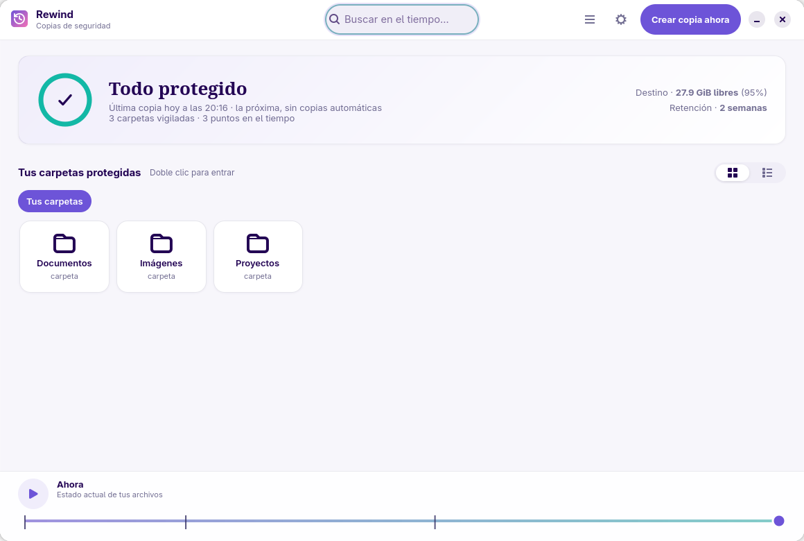
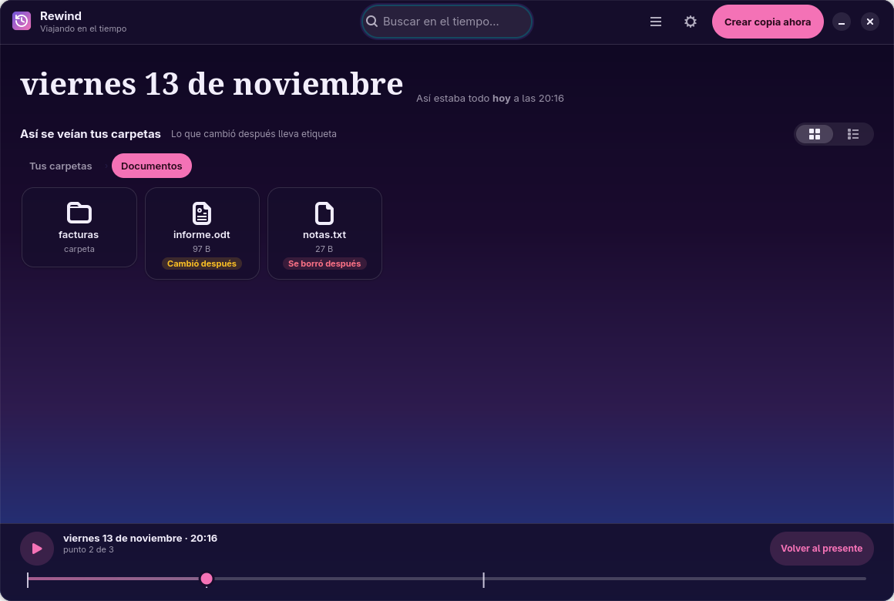
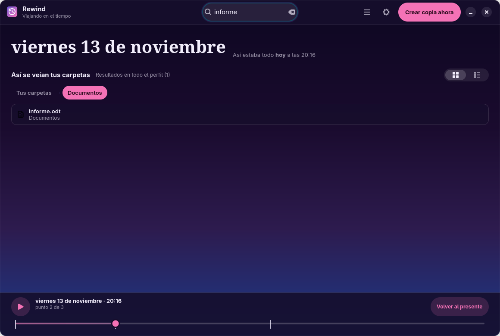
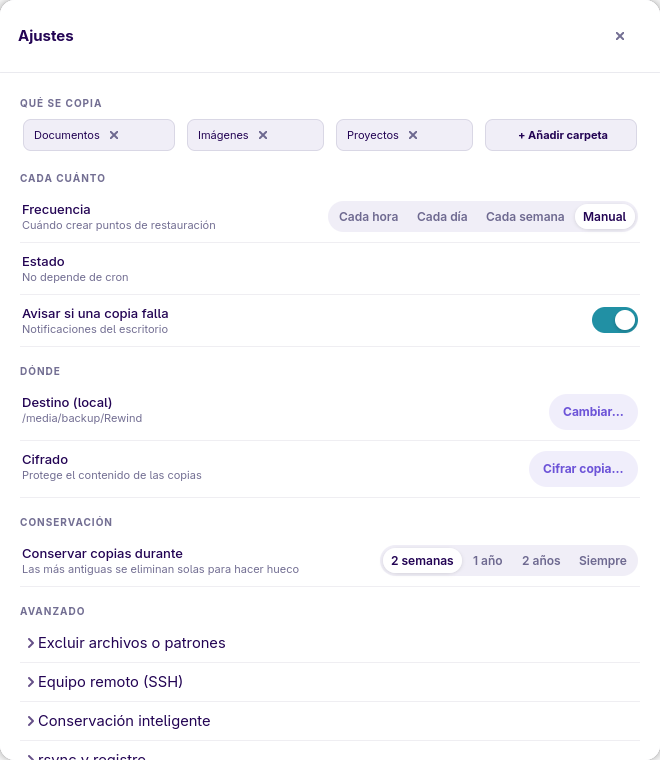

# Back In Time - interfaz GNOME (GTK4 + libadwaita)

Interfaz nativa de GNOME para [Back In Time](https://github.com/bit-team/backintime).
No reimplementa el motor: importa `common/` de Back In Time y maneja
`config.Config`, `snapshots.Snapshots` y `snapshotlog.SnapshotLog` igual que el
cliente Qt.

[English version](README.md)

## Compatibilidad

Funciona con las dos series del núcleo:

| Núcleo | Estado | Perfiles cifrados |
|---|---|---|
| 1.6.x | estable, probado contra 1.6.2 | EncFS |
| 2.0.x | release candidate, probado contra 2.0.0-rc2 | Gocryptfs |

La interfaz detecta el núcleo al arrancar: ofrece los modos de instantánea que
el núcleo soporta, monta el destino con el gestor de montajes de 2.0 cuando
existe y carga la configuración con el propio ayudante de línea de órdenes del
núcleo, para que 2.0 pueda migrar perfiles de versiones anteriores. Los perfiles
Gocryptfs necesitan el binario `gocryptfs` instalado.

## Requisitos

- Python 3.11+ con PyGObject (`python3-gi`). Back In Time 2.0 pide Python 3.13+
- GTK 4.8+ y libadwaita 1.2+ (`gir1.2-gtk-4.0`, `libadwaita-1-0`, `gir1.2-adw-1`)
- `backintime-common` instalado (recomendado) o una copia del repositorio

## Instalación (Arch Linux)

El paquete de la interfaz vive en `packaging/aur` y depende de `backintime-cli`,
que aporta el motor `common/` sin la interfaz Qt6. Hay tres formas de conseguir
ese motor.

**1. Este repositorio, serie 2.0** (el AUR solo distribuye 1.6.x hoy):

```bash
git clone https://github.com/gnacho/backintime-gnome
cd backintime-gnome/packaging/backintime-cli-2.0
makepkg -si
cd ../aur
makepkg -si
```

El paquete del núcleo es `backintime-cli-2.0` (2.0.0-rc2, construido desde el
tag de upstream). Declara `provides`, `conflicts` y `replaces` sobre
`backintime-cli`, así que satisface la dependencia de la interfaz y sustituye al
paquete estable.

**2. AUR, 1.6.x estable**:

```bash
paru -S --asdeps backintime-cli
makepkg -si        # desde packaging/aur
```

**3. Rama git del AUR**: `paru -S --asdeps backintime-cli-git` sigue `dev` y
también declara `provides` y `conflicts` sobre `backintime-cli`.

Sin instalar nada, se puede apuntar la interfaz a una copia del núcleo:

```bash
BACKINTIME_COMMON=/ruta/a/backintime-2.0.0-rc2/common backintime-gnome
```

Instala `/usr/bin/backintime-gnome` y la entrada de menú *Back In Time (GNOME)*.

Los paquetes opcionales habilitan los modos de programación automática:

- `cronie` aporta `crontab` para las programaciones basadas en cron. Después de
  instalarlo, hay que habilitar su servicio con
  `sudo systemctl enable --now cronie.service`.
- `backintime` aporta el servicio D-Bus para las programaciones basadas en udev
  con el núcleo estable 1.6.x. También instala la interfaz Qt6, así que no hace
  falta salvo que se use ese modo.

## Ejecución

```bash
./backintime-gnome
```

`--first-run` abre el asistente aunque el perfil ya tenga carpetas y destino,
también cuando ya hay una instancia abierta. `--help` imprime las opciones del
lanzador. El asistente también se abre solo cuando al perfil le faltan carpetas
o destino.

Si el motor no está en la ruta estándar:

```bash
BACKINTIME_COMMON=/ruta/a/backintime/common ./backintime-gnome
```

Orden de búsqueda de `common/`: `$BACKINTIME_COMMON`,
`~/.local/share/backintime-gnome/common`, `/usr/share/backintime/common`,
`/usr/local/share/backintime/common` y `../backintime/common` (desarrollo).

## Idiomas

El castellano es el idioma fuente: las cadenas viven en el código y una sesión
en castellano no necesita catálogo. El inglés está traducido en `po/en.po` y el
paquete instala su `.mo` en `/usr/share/locale`.

`BACKINTIME_GNOME_LANG` fuerza el idioma con independencia del idioma de la
sesión (por ejemplo `BACKINTIME_GNOME_LANG=en ./backintime-gnome`).

Las capturas de este README están hechas con la interfaz en inglés. Las
castellanas están en `capturas/es/`.

Para añadir un idioma:

```bash
cp po/en.po po/fr.po          # traduce los msgstr
./po/update-po.sh             # regenera la plantilla y fusiona
./po/update-po.sh --build     # compila po/locale/, que es lo que lee una copia del repo
```

## Funciones

La interfaz gira alrededor de dos preguntas: *¿está todo protegido ahora mismo?*
y *¿cómo estaban mis archivos hace tres días?*. El nombre de diseño de ese
planteamiento es **Rewind**; el paquete y el repositorio conservan el nombre
`backintime-gnome`.

- **Modo presente**: tarjeta de estado con la última y la próxima instantánea,
  número de carpetas vigiladas, puntos en el tiempo, espacio libre en el destino
  y la retención configurada. El anillo se pone ámbar cuando la última
  instantánea falló.
- **Modo tiempo**: la ventana cambia a tema oscuro, muestra la fecha del punto
  que estás visitando y marca las entradas que cambiaron o desaparecieron en la
  instantánea siguiente. La línea de tiempo de abajo se mueve entre puntos,
  tiene un botón de reproducción para recorrer la historia y "Volver al
  presente".
- **Navegador**: rejilla (por defecto) o lista, migas de pan, insignias de
  cambio y barra de acciones flotante con restaurar, comparar y parar la copia.
  Las insignias se cachean por punto y carpeta y se calculan fuera del hilo
  principal en carpetas grandes.
- **Buscador**: a partir de dos caracteres, el buscador recorre todo el punto en
  el tiempo en un worker y lista las coincidencias con su carpeta, en vez de
  filtrar solo la carpeta en pantalla. Las rutas se muestran relativas a la
  carpeta copiada (`Documentos/informe.odt`), nunca la ruta completa `/home/...`.
- **Crear copia**: ejecuta `Snapshots.backup(force=True)` en un hilo con un
  diálogo de progreso que lee `takeSnapshotMessage()`. **Parar la copia** mata
  el rsync hijo, el núcleo marca la instantánea parcial como fallida y la
  ventana la descarta (no se guarda nada). **Seguir en segundo plano** cierra el
  diálogo y sigue trabajando, con un aviso al terminar. Cerrar la ventana o
  pulsar Ctrl+Q durante una copia pregunta antes: esperar a que termine, pararla
  y salir, o cancelar el cierre. Ctrl+S.
- **Restaurar**: diálogo con ubicación original u otra carpeta, copia
  `.backup.AAAAMMDD`, `--update` y borrado de archivos nuevos. Llama al
  `Snapshots.restore()` real. Ctrl+R.
- **Borrar instantánea**: confirmación destructiva + `Snapshots.remove()`.
- **Registro**: visor de `takesnapshot_N.log` con filtro de Info, Aviso y Error.
- **Comparar**: diff unificado integrado entre el archivo de la instantánea y el
  anterior (doble clic en un archivo mientras se navega un punto en el tiempo).
- **Aviso de retención**: cuando hay instantáneas fuera de la retención
  configurada, la app dice cuántas son y, para los archivos que solo existen
  ahí, si se perderían o ya tienen una versión más reciente. Menú: *Revisar
  retención*. La fecha de corte y las reglas de borrado salen del núcleo
  (conservar la más antigua, conservar las nombradas) y el análisis lo dice
  cuando no puede leerlo todo. Con 2.0.0-rc2 el núcleo devuelve 1/1/1 para todas
  las unidades, así que nunca borra: la app lo detecta y avisa de que la política
  no se aplicará. Solo se ofrecen días, semanas y años, porque el núcleo no
  borra instantáneas con las demás unidades.
- **Montajes y perfiles**: los destinos SSH y cifrados siguen montados mientras
  la app está abierta, así que navegar un punto en el tiempo funciona; el perfil
  seleccionado se recuerda entre reinicios en
  `~/.config/backintime-gnome/state.ini`.
- **Cifrado local guiado**: el asistente y la hoja de ajustes pueden crear un
  perfil Gocryptfs local con el núcleo 2.0. La app valida la contraseña,
  inicializa el destino con el gestor de montajes de Back In Time, comprueba la
  ruta descifrada de las instantáneas y solo entonces persiste el perfil. Las
  contraseñas no pasan nunca a la configuración ni a los registros de Rewind. Se
  aceptan destinos Gocryptfs ya existentes y se rechaza un directorio no vacío
  sin `gocryptfs.conf`.
- **Hoja de ajustes**: carpetas vigiladas, frecuencia, avisos de fallo, destino,
  cifrado y retención arriba; exclusiones, SSH, borrado inteligente, opciones de
  rsync, nivel de registro y perfiles plegados en desplegables. La ventana
  completa de *Gestionar perfiles* (udev, claves, programaciones a medida) queda
  a un clic. Al elegir allí un modo cifrado local se abre el mismo flujo guiado
  en vez de guardar el modo sin credenciales.
- **Asistente de primer arranque**: carpetas, frecuencia, destino, resumen y la
  primera copia con progreso en vivo.
- El tema claro/oscuro sigue al escritorio en modo presente; el modo tiempo es
  siempre oscuro. Atajos: Ctrl+, Ctrl+S Ctrl+R Ctrl+Q, Izquierda/Derecha para
  moverse entre puntos y Escape para volver al presente.

## Capturas









## Hoja de ruta

- Vista de diff con herramienta externa configurable (`meld`).
- Barra de progreso real durante la restauración.
- Empaquetado Meson/Flatpak.

## Notas

- **Base GTK 4.8 / libadwaita 1.2** (Debian 12): no usa `AdwDialog`,
  `AdwToolbarView`, `AdwAlertDialog` ni `AdwSpinRow` (esos piden GTK 4.10 /
  Adw 1.4+). La migración es trivial cuando suba la base.
- Licencia: GPL-2.0+ (la misma que Back In Time).
