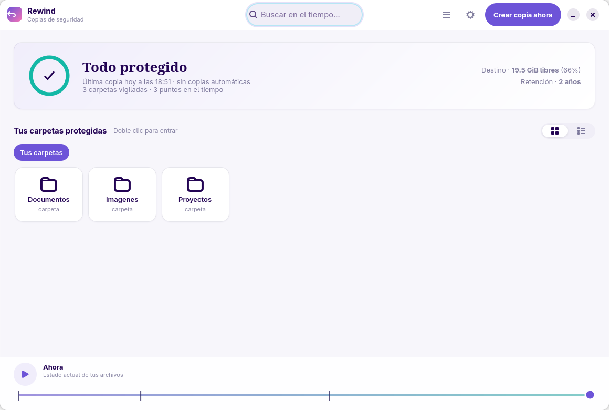
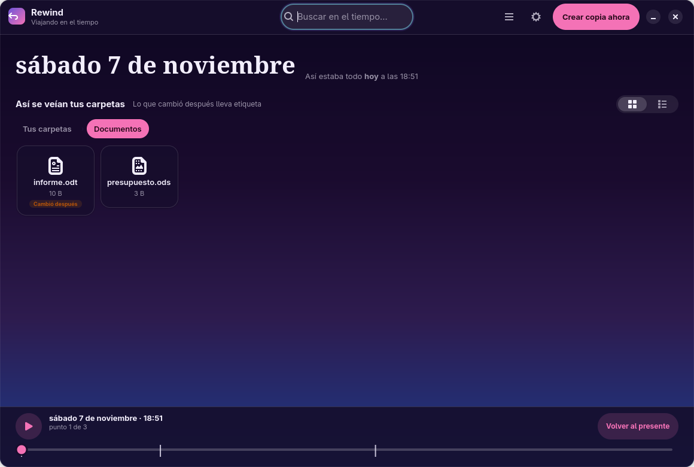
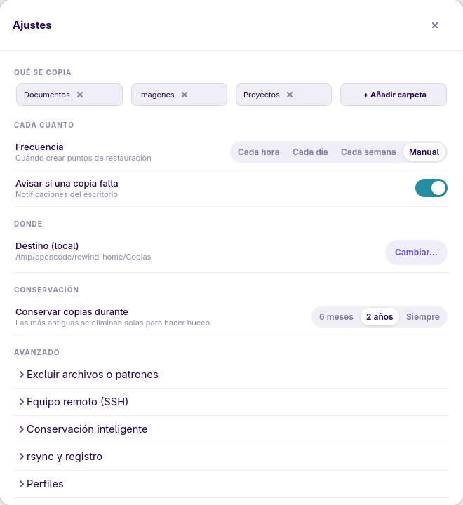

# Back In Time - GNOME frontend (GTK4 + libadwaita)

Native GNOME frontend for [Back In Time](https://github.com/bit-team/backintime).
It does not reimplement the engine: it imports `common/` from Back In Time and
drives `config.Config`, `snapshots.Snapshots` and `snapshotlog.SnapshotLog`
exactly like the Qt client does.

## Compatibility

Both core series work:

| Core | State | Encrypted profiles |
|---|---|---|
| 1.6.x | stable, tested against 1.6.2 | EncFS |
| 2.0.x | release candidate, tested against 2.0.0-rc2 | Gocryptfs |

The frontend detects the core at startup: it exposes the snapshot modes the core
offers, mounts the destination through the 2.0 mount manager when it exists, and
loads the config with the core's own CLI helper so that 2.0 can migrate profiles
from older versions. Gocryptfs profiles need the `gocryptfs` binary installed.

## Requirements

- Python 3.11+ with PyGObject (`python3-gi`). Back In Time 2.0 needs Python 3.13+
- GTK 4.8+ and libadwaita 1.2+ (`gir1.2-gtk-4.0`, `libadwaita-1-0`, `gir1.2-adw-1`)
- `backintime-common` installed (recommended), or a checkout of the repo

## Install (Arch Linux)

The frontend package lives in `packaging/aur` and depends on `backintime-cli`,
which provides the `common/` engine without the Qt6 interface. Three ways to get
that engine.

**1. This repository, 2.0 series** (the AUR only ships 1.6.x today):

```bash
git clone https://github.com/gnacho/backintime-gnome
cd backintime-gnome/packaging/backintime-cli-2.0
makepkg -si
cd ../aur
makepkg -si
```

The core package is `backintime-cli-2.0` (2.0.0-rc2, built from the upstream
tag). It declares `provides`, `conflicts` and `replaces` for `backintime-cli`, so
it satisfies the frontend dependency and swaps out the stable package.

**2. AUR, 1.6.x stable**:

```bash
paru -S --asdeps backintime-cli
makepkg -si        # from packaging/aur
```

**3. AUR git branch**: `paru -S --asdeps backintime-cli-git` follows `dev` and
also provides and conflicts with `backintime-cli`.

Without installing anything, point the frontend at a checkout of the core:

```bash
BACKINTIME_COMMON=/path/to/backintime-2.0.0-rc2/common backintime-gnome
```

It installs `/usr/bin/backintime-gnome` and the *Back In Time (GNOME)* menu entry.

## Run

```bash
./backintime-gnome
```

`--first-run` opens the wizard even when the profile already has folders and a
destination. `--help` prints the launcher options. The wizard also opens by
itself when the profile has no folders or no destination yet.

If the engine is not installed in the standard path:

```bash
BACKINTIME_COMMON=/path/to/backintime/common ./backintime-gnome
```

Search order for `common/`: `$BACKINTIME_COMMON`,
`~/.local/share/backintime-gnome/common`, `/usr/share/backintime/common`,
`/usr/local/share/backintime/common`, and `../backintime/common` (development).

## Features

The interface is built around two questions: *is everything protected right
now?* and *what did my files look like three days ago?*. The design name for
that layout is **Rewind**; the package and the repository keep the
`backintime-gnome` name.

- **Present mode**: status card with the last and next snapshot, number of
  watched folders, points in time, free space on the destination and the
  retention setting. A ring turns amber when the last snapshot failed.
- **Time mode**: the window switches to a dark theme, shows the date of the
  point you are visiting and marks the entries that changed or disappeared in
  the next snapshot. The timeline at the bottom moves between points, has a
  play button to walk the history and "Back to the present".
- **Browser**: grid (default) or list, breadcrumbs, search, change badges and a
  floating action bar with restore, compare and stop copying.
- **Take snapshot**: runs `Snapshots.backup(force=True)` in a thread with a
  progress dialog that reads `takeSnapshotMessage()`. **Parar la copia** kills
  the rsync child; the core marks the partial snapshot as failed, so the window
  discards it (nothing is kept). **Seguir en segundo plano** closes the dialog
  and keeps working, with a toast when it finishes. Ctrl+S.
- **Restore**: dialog with original location or another folder, `.backup.YYYYMMDD`
  copy, `--update` and removal of new files; calls the real
  `Snapshots.restore()`. Ctrl+R.
- **Delete snapshot**: destructive confirmation + `Snapshots.remove()`.
- **Log**: viewer for `takesnapshot_N.log` with Info/Warning/Error filter.
- **Compare**: built-in unified diff between the file in the snapshot and the
  previous one (double click on a file while browsing a point in time).
- **Settings sheet**: watched folders, frequency, failure notifications,
  destination and retention on top; excludes, SSH, smart removal, rsync
  options, log level and profiles folded into expanders. The complete *Manage
  profiles* window (encryption modes, udev, keys, custom schedules) stays one
  click away, so no option is lost.
- **First-run wizard**: folders, frequency, destination, summary and the first
  backup with live progress.
- Light/dark theme follows the desktop in present mode; time mode is always
  dark. Shortcuts: Ctrl+, Ctrl+S Ctrl+R Ctrl+Q, Left/Right to move between
  points and Escape to go back to the present.

## Screenshots







## Roadmap

- Diff view with a configurable external tool (`meld`).
- Real progress bar during restore.
- Meson/Flatpak packaging and translations (reuse `common/po`).

## Notes

- **GTK 4.8 / libadwaita 1.2** baseline (Debian 12): it does not use
  `AdwDialog`, `AdwToolbarView`, `AdwAlertDialog` or `AdwSpinRow` (those need
  GTK 4.10 / Adw 1.4+). Migration is trivial once the baseline moves up.
- License: GPL-2.0+ (same as Back In Time).
