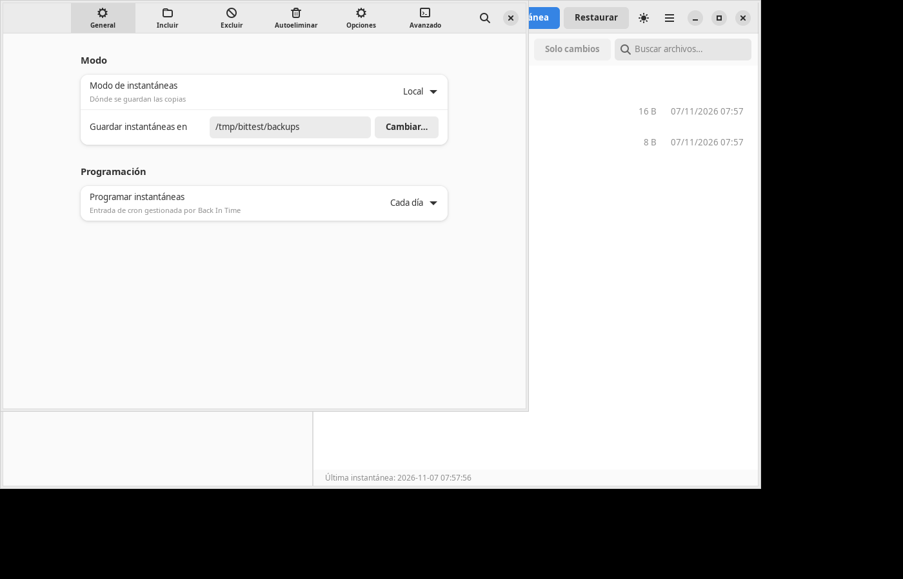

# Back In Time - GNOME frontend (GTK4 + libadwaita)

Native GNOME frontend for [Back In Time](https://github.com/bit-team/backintime).
It does not reimplement the engine: it imports `common/` from Back In Time and
drives `config.Config`, `snapshots.Snapshots` and `snapshotlog.SnapshotLog`
exactly like the Qt client does.

## Compatibility

Both core series work:

| Core | State | Encrypted profiles |
|---|---|---|
| 1.6.x | stable, tested against 1.6.2 | EncFS |
| 2.0.x | release candidate, tested against 2.0.0-rc2 | Gocryptfs |

The frontend detects the core at startup: it exposes the snapshot modes the core
offers, mounts the destination through the 2.0 mount manager when it exists, and
loads the config with the core's own CLI helper so that 2.0 can migrate profiles
from older versions. Gocryptfs profiles need the `gocryptfs` binary installed.

## Requirements

- Python 3.11+ with PyGObject (`python3-gi`). Back In Time 2.0 needs Python 3.13+
- GTK 4.8+ and libadwaita 1.2+ (`gir1.2-gtk-4.0`, `libadwaita-1-0`, `gir1.2-adw-1`)
- `backintime-common` installed (recommended), or a checkout of the repo

## Install (Arch Linux)

The package definition lives in `packaging/aur` and depends on `backintime-cli`
(AUR), which provides `common/` without pulling in the Qt6 interface.

```bash
git clone https://github.com/gnacho/backintime-gnome
cd backintime-gnome/packaging/aur
paru -S --asdeps backintime-cli
makepkg -si
```

It installs `/usr/bin/backintime-gnome` and the *Back In Time (GNOME)* menu entry.

`backintime-cli` in the AUR still ships 1.6.2. To run against 2.0.x, download the
release candidate and point the frontend at its `common/` directory:

```bash
BACKINTIME_COMMON=/path/to/backintime-2.0.0-rc2/common backintime-gnome
```

## Run

```bash
./backintime-gnome
```

If the engine is not installed in the standard path:

```bash
BACKINTIME_COMMON=/path/to/backintime/common ./backintime-gnome
```

Search order for `common/`: `$BACKINTIME_COMMON`,
`~/.local/share/backintime-gnome/common`, `/usr/share/backintime/common`,
`/usr/local/share/backintime/common`, and `../backintime/common` (development).

## Features (milestone 1)

- **Main window**: real snapshot list grouped by age (Today/Yesterday/This
  week/Older) with a "Now" entry; browser for the content of each snapshot or
  the current system, with breadcrumbs, up-level and search.
- **Changes only**: compares the selected snapshot with the previous one
  (New/Modified badges).
- **Take snapshot**: runs `Snapshots.backup(force=True)` in a thread with a
  progress dialog that reads `takeSnapshotMessage()`; toast on completion and
  list reload. Ctrl+S.
- **Restore**: dialog with original location or another folder, `.backup.YYYYMMDD`
  copy, `--update` and removal of new files; calls the real
  `Snapshots.restore()`. Ctrl+R.
- **Delete snapshot**: destructive confirmation + `Snapshots.remove()`.
- **Log**: viewer for `takesnapshot_N.log` with Info/Warning/Error filter.
- **Compare**: built-in unified diff between the file in the snapshot and the
  previous one (double click on a file while browsing a snapshot).
- **Profiles**: header bar selector (switches the real `currentProfile`) and a
  *Manage profiles* window with the six pages of the Qt client:
  General (Local/SSH/encrypted mode, destination, SSH, cron/udev schedule),
  Include and Exclude (editable lists with a real file chooser),
  Auto-remove (age + smart removal), Options and Advanced.
  Everything writes through the `config.Config` setters and `cfg.save()`.
- Light/dark theme, F9 for the sidebar, shortcuts (Ctrl+, Ctrl+S Ctrl+R Ctrl+Q).

## Screenshots




## Roadmap

- First-run wizard (restore the config from an old backup).
- Diff view with a configurable external tool (`meld`).
- Real progress bar during restore.
- Meson/Flatpak packaging and translations (reuse `common/po`).

## Notes

- **GTK 4.8 / libadwaita 1.2** baseline (Debian 12): it does not use
  `AdwDialog`, `AdwToolbarView`, `AdwAlertDialog` or `AdwSpinRow` (those need
  GTK 4.10 / Adw 1.4+). Migration is trivial once the baseline moves up.
- License: GPL-2.0+ (same as Back In Time).
